<p align="center">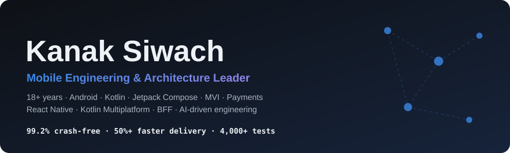</p>

<p align="center">
  <a href="https://kanak86.github.io/kanak-siwach-portfolio/"><b>▶ Open the interactive portfolio</b></a> ·
  <a href="https://www.linkedin.com/in/kanaksiwach">LinkedIn</a> ·
  <a href="mailto:kanak86.us@gmail.com">Email</a>
</p>

> **18+ years** building consumer mobile apps at scale. Most recently **Senior Staff Engineer at GOAT** (platform serving ~120K daily active users), where I led the Fawkes Android architecture rewrite, owned checkout payments, and rolled out AI agents that cut UI development time by 50%+.
> This repository is a guided tour of *how* I build: architecture diagrams, live demos, and small original code samples. It contains **no employer code**.

## AI-driven engineering

At GOAT I wrote **20 of the 40** Claude Code agents and skills in our Android team's AI toolkit, covering planning, code migration, PR workflow, crash triage and docs.

| | |
|---|---|
| **72 presenters** migrated to MVI with two migration skills I wrote | **50%+** less UI development time with Claude Code agents, including Figma-to-Compose |
| **1 ticket per crash**: `crash-correlator` merges Play Console and Embrace crashes and has `jira-ticketer` create or update a single ticket | **Ticket to PR**: `jira-ticketer`, `pr-orchestrator` and `pr-validator` |

| crash-correlator (simulated data) | migrate-presenter |
|---|---|
| 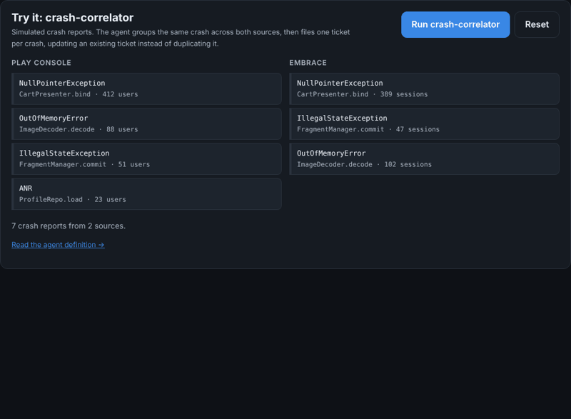 | 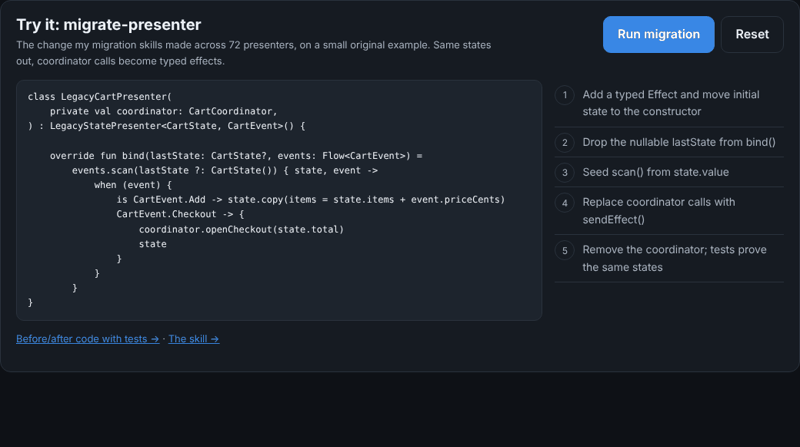 |

→ Original examples: [`crash-correlator` agent](samples/claude-agents/.claude/agents/crash-correlator.md) · [`migrate-presenter` skill](samples/claude-agents/.claude/skills/migrate-presenter/SKILL.md) · [before/after presenter with tests](samples/mvi-core/src/main/kotlin/dev/kanak/mvi/migration)

## Impact at a glance

| | |
|---|---|
| **91.9% → 99.2%** crash-free rate within 2 months of the Fawkes release | **~50%** faster feature development and rollout on one MVI + Compose framework |
| **9 engineers, 11 months**: consolidated fragmented legacy codebases into one architecture | **iOS parity in 3 months** after Fawkes shipped |
| **20%+** order completion from Klarna and Affirm integration | **40%+** order completion, **60%+** engagement from Ticketmaster In-Venue Seating |
| **50%+** less UI development time with custom Claude Code agents | **90%+** test coverage, 4,000+ unit tests at Grindr |
| **2.3 → 3.8 stars** Play Store rating within 6 months of the DIRECTV NFL Sunday Ticket relaunch (85% → 98% crash-free on rewritten flows) | **48% → 100%** ad delivery rate with the AppJacket in-app ad SDK at Seventy9 |

## Try it in 30 seconds

Everything below runs in the browser on the [interactive site](https://kanak86.github.io/kanak-siwach-portfolio/#demos): move the sliders, press the buttons.

| Architecture explorer | Checkout eligibility + state machine | BFF parallel fan-out |
|---|---|---|
| 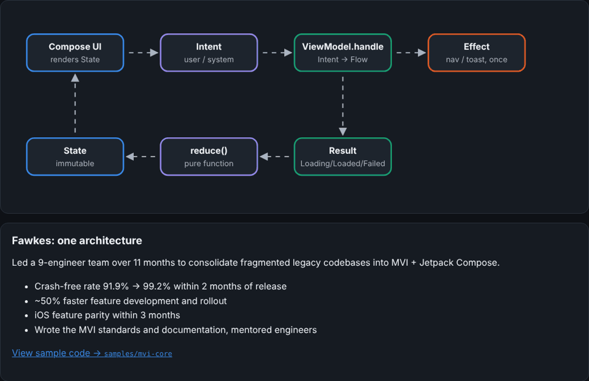 | 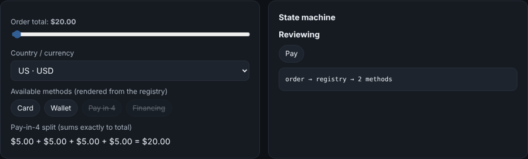 | 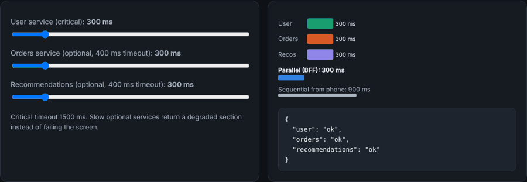 |

## What I've built

### 1 · One architecture for a whole app: MVI + Jetpack Compose
Led a 9-engineer team through an 11-month transformation of the Fawkes app. One immutable state, pure reducers, one-shot effects.
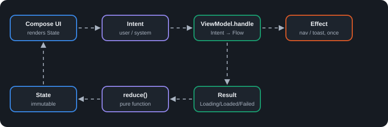

→ Code: [`samples/mvi-core`](samples/mvi-core) (container, feature, tests) · Compose screen: [`ProductListScreen.kt`](samples/mvi-core/compose-snippet/ProductListScreen.kt)

### 2 · Checkout and payments
Owned the Checkout pod across Klarna, Affirm, GOAT Pay and Google Pay. Each provider declares its own eligibility; the UI renders what the registry returns.
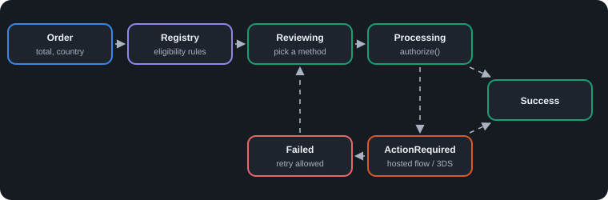

→ Code: [`samples/checkout-payments`](samples/checkout-payments)

### 3 · Cross-platform: React Native and Kotlin Multiplatform
Led Ticketmaster's migration to a unified React Native codebase and bridged the interactive venue map as a native module. Prototyped Kotlin Multiplatform for GOAT's Sneakers.com vertical, for synchronized Android/iOS feature development: share the rules, keep the UI native.

<table><tr><td>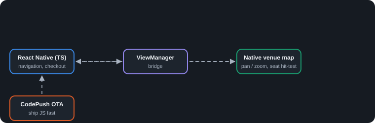</td><td>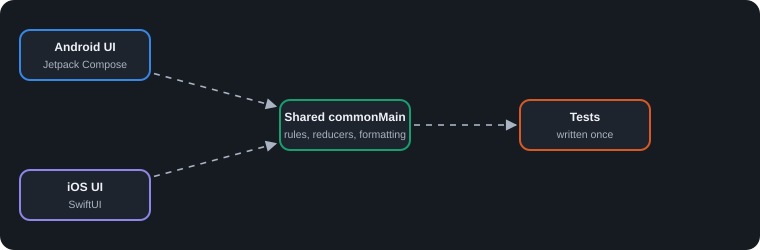</td></tr></table>

→ Code: [`samples/rn-native-module`](samples/rn-native-module) · [`samples/kmp-shared`](samples/kmp-shared)

### 4 · Backend-for-frontend
Built a custom backend service at Ticketmaster and worked with Java / Spring Boot REST services at GOAT. The sample shows the BFF pattern: parallel fan-out, per-call timeouts, graceful degradation.
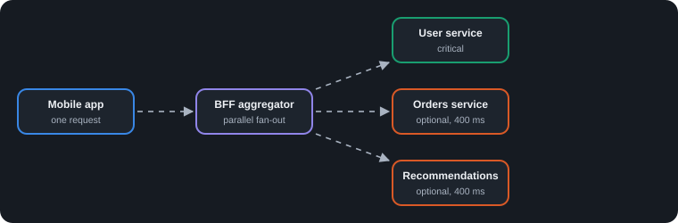

→ Code: [`samples/bff-core`](samples/bff-core)

### 5 · AI-driven engineering
Wrote 20 of the 40 agents and skills in the team's Claude Code toolkit (see [AI-driven engineering](#ai-driven-engineering) above), including a Figma-to-Compose agent.
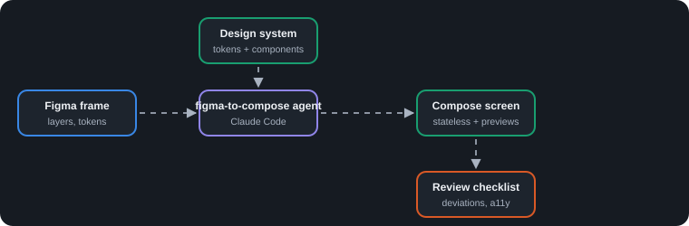

→ Examples: [`samples/claude-agents`](samples/claude-agents)

## Career

| Role | Company | Period |
|---|---|---|
| Sr. Engineer II → Staff → Senior Staff Engineer | GOAT Group | Jun 2018 – Aug 2026 |
| Lead Android Developer | UpKeep Maintenance Management | Mar 2018 – Jun 2018 |
| Lead Android Developer | Grindr | Apr 2017 – Feb 2018 |
| Senior Android Developer | Ticketmaster | Jul 2015 – Apr 2017 |
| Sr. Android Developer | Calance (DIRECTV): sole developer of NFL Sunday Ticket; MVVM rewrite with RecyclerView and tablet UI | Oct 2013 – Jul 2015 |
| Sr. Android Application Developer | Seventy9 Media: led a team of 4 on AppJacket, an in-app ad SDK (video, banner, interstitial) | Jun 2013 – Oct 2013 |
| Sr. Software Engineer | Infoedge India (Naukri.com): built the Android app from scratch; 254 KB hybrid WebView app; PHP / CodeIgniter APIs and SOA services | Oct 2011 – Jun 2013 |
| Sr. Software Engineer | Buongiorno: telecom subscription and billing engine (IN / Diameter) for ETISALAT, AIRTEL, IDEA | Aug 2008 – Oct 2011 |

## Tech

**Android** Kotlin · Jetpack Compose · Material 3 · Coroutines/Flow · Hilt · Room · WorkManager · Paging 3 · Accessibility
**Architecture** MVI · MVVM · Clean Architecture · modular design · design systems
**Cross-platform** React Native · native modules · Kotlin Multiplatform · CodePush
**Payments** Klarna · Affirm · Google Pay · Google Play Billing
**Backend** REST · GraphQL · gRPC · WebSockets · Java / Spring Boot (collaboration) · PHP / CodeIgniter · SOA · MySQL · SQLite · telecom billing · BFF pattern
**Quality** JUnit · MockK · Turbine · Espresso · Robolectric · Compose UI tests · Paparazzi
**AI** Claude Code agents & skills · prompt engineering · Figma-to-Compose automation
**CI/CD** GitHub Actions · Bitrise · Jenkins · Fastlane · Gradle optimization · Play staged rollouts

## Repository map

```
docs/       interactive site (GitHub Pages): AI work, skills, experience timeline, architecture explorer, live demos
assets/     animated SVG diagrams and demo GIFs
samples/    original Kotlin / TypeScript examples (CI runs the JVM tests)
```

## Contact

**Kanak Siwach** · Sacramento, CA · [kanak86.us@gmail.com](mailto:kanak86.us@gmail.com) · [linkedin.com/in/kanaksiwach](https://www.linkedin.com/in/kanaksiwach)
